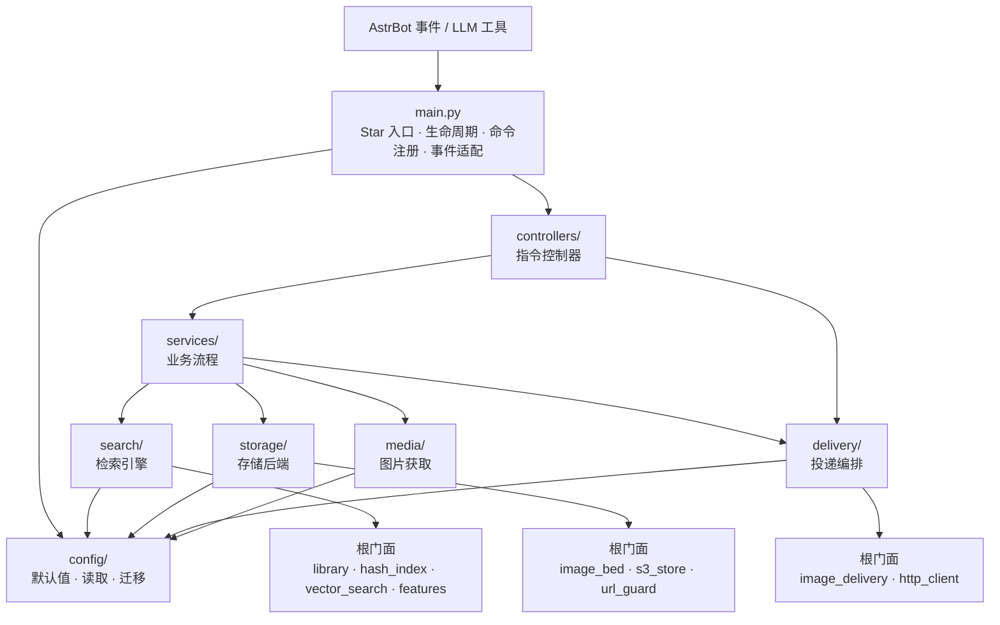

# 架构说明

本文描述 `astrbot_plugin_image_trace` 在 1.8.0 的分层结构与调用链，用于二次开发与排障。行为细节以代码为准；配置项含义见 [README](./README.md#配置分组)。

## 分层总览



依赖方向只有两种：

- **自上而下**：`main → controllers → services → 领域子包 → 根门面`；
- **横向复用**：子包之间只允许引用 `config` / `common` / `http_client` / `url_guard` 这类无业务语义的公共件，且**不得反向 `import main`**。`services` 与 `controllers` 通过构造函数拿到插件实例（作为 host 门面）或配置对象，再调用其公开成员。

## 各层职责

### 入口层 `main.py`

`ImageTracePlugin` 是唯一的 `Star` 子类，负责：

1. **生命周期**：`__init__` 组装数据目录、配置迁移、图库、存储、向量引擎、哈希索引、签到库、图片获取器与控制器；`initialize` / `terminate` 处理启动刷新、临时文件清理与资源关闭；
2. **事件适配**：`_extract_images` 解析消息链与引用消息，`_delivery_target` 生成平台画像，`_resolve_local` 委托 `media.ImageSource`；
3. **命令注册**：`@filter.command` / `@filter.llm_tool`，权限用 `@filter.permission_type(filter.PermissionType.ADMIN)`；
4. **薄委托**：为保持既有调用点与测试中的 `monkeypatch(plugin._xxx)` 有效，`main` 保留了一批同名方法，方法体只转发到子包。

### 控制器层 `controllers/`

只处理「这条指令该怎么跑」：校验权限、解析参数、组织回复，不实现检索/存储/发送细节。

| 模块 | 指令 |
| --- | --- |
| `trace.py` | `/溯源`、`/溯源状态`、`/溯源帮助` |
| `register.py` | `/登记原图` |
| `original.py` | `/原图`、`/原图修复` |
| `random.py` | `/随机图`、`/随机视频`、LLM 工具 `sendRandomMedia` |
| `checkin.py` | `/签到`、`/签到文案导入` |
| `admin.py` | `/溯源昵称`、`/溯源重扫`、`/溯源删除` |

### 服务层 `services/`

承载多步骤业务流程，统一通过 host 门面访问图库、向量、存储、发送等能力。

| 模块 | 流程 |
| --- | --- |
| `trace_service.py` | 哈希 / 向量 / auto 三条检索路径、命中渲染与回传、候选提示 |
| `original_service.py` | 文件名反查、缩略图反查、图床直链探测 |
| `random_service.py` | 随机接口取图、缩略图替身、发送 |
| `checkin_service.py` | 签到记账、取图、文案/卡片、失败回退 |
| `checkin_identity.py` | 签到者群昵称解析（OneBot 群成员接口优先，回退事件昵称）与 `/溯源昵称` 诊断共用 |

### 检索层 `search/`

| 模块 | 职责 |
| --- | --- |
| `base.py` | `SearchHit` / `QueryImage` / `SearchOutcome` 统一模型、`SearchEngine` 协议、`miss_message` |
| `hash_engine.py` | 本地图库 + 图床哈希镜像两条腿的合并排序、候选行 |
| `vector_engine.py` | 把 `vector_search.VectorEngine` 的原始结果收敛为统一命中（阈值、降序、同图去重） |
| `auto_engine.py` | 向量优先、未命中或不可用时回退哈希 |
| `embedding_client.py` | 图片序列化 + OpenAI 兼容 `/v1/embeddings` 请求 |
| `qdrant_client.py` | Qdrant REST：检索、翻页、计数、payload 精确反查、写入与删除 |
| `errors.py` | `VectorEngineError` / `HttpError` / `InvalidEmbeddingJSON` 与响应解析 |

`search/__init__.py` 用 PEP 562 惰性导出，避免 `vector_search → search → vector_engine → vector_search` 的循环导入。

### 存储层 `storage/`

| 模块 | 职责 |
| --- | --- |
| `protocol.py` | `ImageStore` 协议与 `StoreResult` |
| `registry.py` | `StorageRegistry` 按配置构造生效存储，`ImageBedStoreAdapter` 适配旧门面 |
| `modes.py` | `MODE_LOCAL` / `MODE_HTTP` / `MODE_R2` / `MODE_OCI` / `MODE_CFB` |
| `local_backend.py` | 本地副本（`<data_dir>/images`） |
| `http_backend.py` | 通用 HTTP 图床（Lsky Pro / EasyImages / Chevereto…） |
| `cloudflare_backend.py` | CloudFlare-ImgBed 上传与批量删除 |
| `object_backend.py` | R2 / OCI 的 S3 兼容上传、删除与直链反解 |
| `backend_utils.py` | 超时、待上传文件命名与读取 |
| `urls.py` | 直链拼接、嵌套 JSON 取值、同源判定 |

### 投递层 `delivery/`

| 模块 | 职责 |
| --- | --- |
| `types.py` | `DeliveryRequest` / `DeliveryResult` / `DeliveryProfile` / `DeliveryConfig` / `DeliveryContext` |
| `planner.py` | 纯函数 `plan_delivery`：把请求 + 平台画像 + 配置折算成候选步骤 |
| `service.py` | `DeliveryService.deliver`：事件去重 → offbox 前置 → 计划 → 选通道 → 执行 → 记账 |
| `channels.py` | `OneBotChannel`（URL / 压缩字节）、`QQOfficialChannel`（体检 + 上传接管）、`ChainChannel`（标准消息链） |
| `primitives.py` | 字节级 / 消息段级原语：OneBot 直发、本地压缩、URL 计划、配文与 @ 前缀 |

投递层集中保证五条不变量：同一事件只投递一次；`UNKNOWN` / 超时按已送达、绝不重发；只有明确 `failed` 才换通道；「已压缩」配文只按实测证据写入；QQ 官方接管已发图后不再交回。

### 图片获取层 `media/`

`image_source.py`：图片段 → 本地路径 / 字节，URL 存在性探测，坏图分诊。不引用 AstrBot 事件类型，出网经注入的 `GuardedHttpClient`。

### 配置层 `config/`

| 模块 | 职责 |
| --- | --- |
| `typed.py` | 8 个配置数据类，默认值的唯一来源 |
| `loader.py` | 读取门面：新布局优先、旧键回落、类型归一化 |
| `migrations.py` | 布局版本迁移与储存桶迁移（只搬移、不删旧键，幂等） |

## 根目录门面与遗留模块

`main.py` 之外，根目录保留了重构前的公共模块。它们是**兼容门面或纯工具**，子包仍按原路径导入：

| 模块 | 角色 |
| --- | --- |
| `image_bed.py` | 存储统一入口，按 mode 选择 `storage/` 后端并保留原返回文案 |
| `vector_search.py` | 向量引擎门面（配置判定 + 出网），协议细节在 `search/` |
| `library.py` | SQLite 图库 + 内存哈希位矩阵检索 |
| `hash_index.py` | 图床预置 pHash 的本地镜像索引 |
| `features.py` | pHash / dHash / aHash 特征计算 |
| `image_delivery.py` | URL 缩放/还原、压缩证据、直发结果分类等纯函数 |
| `s3_store.py` | AWS SigV4 签名与最小 S3 兼容客户端 |
| `url_guard.py` / `http_client.py` | SSRF 校验与受管 HTTP 客户端 |
| `media_history.py` | 会话级原图历史（LRU + 别名键） |
| `random_media.py` | 随机图接口客户端与响应解析 |
| `weibo_posts.py` | 微博文案解析与映射表读写 |
| `checkin_store.py` / `checkin_card.py` | 签到 SQLite 记录 / 语句库与卡片合成 |
| `common.py` | 无业务语义的小工具与共享常量 |

## 典型调用链

### `/溯源`（auto 引擎）

```text
main.ImageTracePlugin.trace
  → controllers.trace.TraceController.trace
      读取 basic.search_engine；auto 且向量可用时逐图调用
  → services.trace_service.TraceService._trace_auto
  → search.auto_engine.AutoSearchEngine.search_outcome
      ├─ search.vector_engine.VectorSearchEngine.search_outcome
      │    → vector_search.VectorEngine.embed_file
      │        → search.embedding_client.EmbeddingClient.embed_bytes
      │        → search.qdrant_client.QdrantClient.search
      └─ 未命中/不可用：search.hash_engine.HashSearchEngine.merged_candidates
           → library.ImageLibrary.search（本地图库）
           → hash_index.HashIndex.search（图床镜像）
  → main._yield_delivery（薄委托）
  → delivery.service.DeliveryService.deliver
      → delivery.planner.plan_delivery
      → delivery.channels.OneBotChannel / QQOfficialChannel / ChainChannel
      → delivery.primitives（OneBot 直发 / 本地压缩 / URL 计划）
```

### `/登记原图`

```text
controllers.register.RegisterController.register_image
  → main._resolve_local → media.image_source.ImageSource.resolve
  → features.compute_features_with_mime（asyncio.to_thread）
  → plugin.library.add_if_absent（锁内查重）
  → plugin.storage.active.store
      → storage.registry.ImageBedStoreAdapter → image_bed.ImageBedClient
      → storage.local_backend / http_backend / cloudflare_backend / object_backend
  → 可选：search.qdrant_client.QdrantClient.upsert_file
```

### `/原图`

```text
controllers.original.OriginalController.original_image
  → main.history（MediaHistory，本会话回传历史）
  → services.original_service.OriginalService
      → QdrantClient.original_info_for_thumb（缩略图 → 原图）
      → QdrantClient.original_by_file_name / file_name_matches（裸名 → 带目录直链）
      → media.image_source.ImageSource.probe（直链存在性）
  → main._yield_delivery → delivery
```

### `/随机图` / `/随机视频`

```text
controllers.random.RandomController.random_image
  → services.random_service.RandomService._random_media_delivery
      → random_media.RandomMediaClient.fetch
      → main._random_send_url（QdrantClient.thumb_url_for 取缩略图替身）
  → main._yield_delivery → delivery
```

### `/签到`

```text
controllers.checkin.CheckinController.checkin
  → services.checkin_service.CheckinService._checkin_flow
      → checkin_store.CheckinStore.check_in（按配置时区算日期）
      → 取图：services.random_service.RandomService / weibo_posts 映射表
      → 文字：checkin_card.QuoteLibrary
      → 卡片：checkin_card.compose_poster（失败回退 simple）
      → 昵称：services.checkin_identity.checkin_sender_name
  → main._yield_delivery / 标准消息链
```

### `/溯源重扫`

```text
controllers.admin.AdminController.rescan
  → main._collect_image_files（os.walk，过滤 IMAGE_EXTS）
  → features.compute_features（asyncio.to_thread）
  → library.ImageLibrary.add_many / prune_scan_missing
```

### 图床哈希索引刷新

```text
TraceController.trace → main._maybe_start_remote_hash_refresh（TTL 判定）
  → main.start_remote_hash_refresh（后台任务）
  → main._refresh_remote_hash
  → vector_search.VectorEngine.scroll_payloads → search.qdrant_client.QdrantClient
  → asyncio.to_thread(hash_index.HashIndex.build)（落盘 remote_phash.json）
```

## 扩展点

### 新增投递通道

1. 在 `delivery/channels.py` 实现一个类，提供 `deliver_url(ctx)` 与/或 `deliver_bytes(ctx)`，返回 `delivery.types.DeliveryResult`；
2. 在 `delivery/planner.py` 的 `stages` 中加入新步骤名（该函数是纯函数，只决定候选顺序）；
3. 在 `delivery/service.py` 的 `deliver` 中为步骤名增加执行分支，并复用 `EventGuard` 记账；
4. 通道所需的字节级能力优先走 `delivery/primitives.py`，不要在通道内直接拼 AstrBot 消息组件。

### 新增检索引擎

1. 在 `search/` 新建模块，提供 `async search(image) -> list[SearchHit]`（满足 `search.base.SearchEngine` 协议）；如需参与 auto 的「未命中 / 不可用」判定，再补 `search_outcome(image) -> SearchOutcome`；
2. 在 `search/__init__.py` 的 `_LAZY_EXPORTS` / `__all__` 中登记；
3. 在 `config/loader.engine_choice` 与 `_conf_schema.json` 的 `basic.search_engine.options` 中增加取值；
4. 在 `controllers/trace.py` 增加分支，或在 `services/trace_service.py` 中接入；
5. 保持 `SearchHit` 字段口径（`similarity` / `image_url` / `file_path` / `file_size` / `raw`），渲染与回传层只认这一种模型。

### 新增存储后端

1. 在 `storage/` 新建后端模块，实现 `storage.protocol.ImageStore` 的 `store(src_path) -> StoreResult`、`delete(url) -> bool` 与 `src_path(url) -> str`；
2. 在 `storage/modes.py` 增加 `MODE_*`，在 `image_bed.ImageBedClient` 按 mode 分派；
3. `storage/registry.StorageRegistry` 仍以 `ImageBedClient` 为唯一实现入口，无需改发送链路；
4. 在 `_conf_schema.json` 的 `image_bed.mode`（或 `storage_bucket.mode`）增加选项与字段；
5. 上传失败必须回退本地副本，删除必须只影响插件写入的对象。

### 新增配置项

1. 在 `config/typed.py` 的对应数据类加字段与默认值；
2. 在 `config/loader.py` 增加读取函数（或复用 `dict_group` / `int_cfg` / `bool_cfg`）；
3. 在 `_conf_schema.json` 对应分组加条目；若涉及旧键改名，在 `config/migrations.py` 增加幂等搬移并保留隐藏旧键；
4. 不在业务代码里写第二份默认值。

## 关键约束速查

- **SSRF**：所有插件主动出网都经 `url_guard` / `GuardedHttpClient`；不要新建裸 `aiohttp.ClientSession`。
- **哈希口径**：pHash 十六进制长度只由 `features.phash_hex_len(hash_size)` 给出；本地图库与图床镜像必须复用同一套 popcount 与相似度公式。
- **配置读取**：新布局优先、旧键回落；默认值只来自 `config/typed.py`；不要用 `value or default`。
- **异步边界**：SQLite、大文件复制、图像解码等同步重活必须 `asyncio.to_thread`。
- **文案脱敏**：含内网地址 / Key 的错误细节只进日志，不进群聊。
- **发布清单**：新增子包改 `scripts/build_release.py` 的 `RUNTIME_PACKAGES`，新增数据文件改 `DATA_FILES`。
