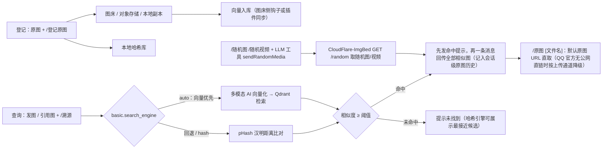

<div align="center">


# 图片溯源 · AstrBot Plugin

**群聊里随手转发的一张图，一键找回它的原图。**

[](./CHANGELOG.md)
[](https://github.com/AstrBotDevs/AstrBot)
[](https://www.python.org/)
[](./LICENSE)

<sub>感知哈希（pHash）+ Qdrant 多模态向量<b>双引擎</b> · OneBot 原生 URL 直传 · CloudFlare-ImgBed / R2 / OCI / 自建图床</sub>

[快速开始](#快速开始) · [指令](#指令) · [配置分组](#配置分组) · [数据与索引](#数据与索引存放位置) · [部署与升级](#部署与升级) · [开发与测试](#开发与测试) · [发布流程](#发布流程) · [架构说明](./ARCHITECTURE.md) · [更新日志](./CHANGELOG.md)

</div>

---

> [!IMPORTANT]
> **AI 生成声明**：本项目代码由 AI 编程助手辅助生成，经人工审查与多轮安全审计后发布；文档中的服务对接内容依据各服务官方文档整理。使用或二次分发前请自行审阅代码。

## 目录

| | | |
| --- | --- | --- |
| [插件能力](#插件能力) | [指令](#指令) | [快速开始](#快速开始) |
| [配置分组](#配置分组) | [数据与索引](#数据与索引存放位置) | [部署与升级](#部署与升级) |
| [开发与测试](#开发与测试) | [发布流程](#发布流程) | [工作原理](#工作原理) |
| [常见问题](#常见问题) | [参与贡献](#参与贡献) | [许可证](#许可证) |

## 插件能力

| 能力 | 说明 |
| --- | --- |
| 🔍 **发图溯源** | 与图片同条消息（或引用图片）发送 `/溯源`，按当前引擎检索最相似的原图，相似度达标即回传 |
| 🧠 **向量引擎**（可选） | 多模态向量 AI（OpenAI 兼容 `/v1/embeddings`）+ Qdrant 检索，对压缩、缩放、裁剪、水印比哈希更鲁棒 |
| 🧮 **哈希引擎**（可离线） | pHash / dHash / aHash，纯 Pillow + numpy 实现，无需 GPU，数万张图毫秒级比对。开启「图床哈希索引」后，图床里的原图也能被哈希直接反查 |
| ⚡ **URL 直传** | QQ `aiocqhttp` 经 OneBot 原生接口直传图床 URL（避免适配器转 base64），失败自动回退本地压缩，最后回退标准消息链 |
| 🧩 **一次一条** | 向量命中的多张相似图合并为**一条**消息，配文集中在开头（带 `1.`/`2.` 序号）、图片连续排在末尾 |
| 🗂️ **多种存储** | 图床副本 / 通用 HTTP 图床（Lsky Pro、EasyImages、Chevereto…）/ CloudFlare-ImgBed / Cloudflare R2 / 甲骨文 OCI |
| 🎲 **随机图** | `/随机图`、`/随机视频` 从图床随机接口取图回传，并可被 LLM 工具 `sendRandomMedia` 调用 |
| 📅 **每日签到** | `/签到` 每天首次计入连续/累计天数；同日重复签到天数不变，但仍会回传一张新的随机卡片/图片。合成方式（`card` / `simple`）、取图方式（`thumbnail` / `original`）、是否写文字与是否带群昵称各自独立配置 |
| 🖼️ **`/原图` 直取** | 引用机器人发过的图时，优先按**发送记录**精确取回：发图通道回执 `message_id`，引用消息带 `Reply.id`，两者对上就直接拿当时发出的原图，不下载、不算哈希；没有记录（旧消息 / AstrBot 代发消息链）时才按文件名、缩略图或图片内容兜底。无引用时从会话历史找回，或按文件名直接到图床取。常规路径原图 URL 直传、不下载不本地中转。QQ 官方机器人拿不到公网直链时按上传通道降级 |
| 🧹 **名字自动净化** | 配文前缀（`🖼️`/`🎬`/序号）与图床改名痕迹（毫秒时间戳、`@`→`_`）在展示与直查前统一剥净 |
| 🛡️ **安全加固** | 插件自身发起的全部出网（下载兜底、图床 / 对象存储 / Qdrant / 随机图 / 语句接口）经 SSRF 防护（逐跳校验 + IP 钉扎 + 响应限长）；密钥字段在配置面板标记为 secret。平台适配器自身的上传/拉流请求由其负责，不经过本插件的 `url_guard` |

> [!NOTE]
> `/溯源` 日常查询只依赖配置好的向量 AI 与 Qdrant；哈希引擎可全程本地运行，不依赖任何外部服务。图床哈希索引的**拉取**需要 Qdrant 可达，但拉下来之后检索全程离线。

## 指令

命令注册全部在 [`main.py`](./main.py) 的 `ImageTracePlugin` 上，处理器实现在 [`controllers/`](./controllers)。

| 指令 | 别名 | 说明 | 权限 |
| --- | --- | --- | --- |
| `/溯源` | `/找原图` | 与图片同条消息发送，或引用图片发送，检索并回传原图 | 所有人 |
| `/登记原图 [备注]` | `/原图登记` | 将图片作为原图登记入库 | 默认仅管理员（`basic.register_admin_only`） |
| `/原图 [文件名]` | - | 带文件名时直接到图床按名取；不带文件名时优先取被引用的图，无引用才取本会话最近回传的原图 | 所有人 |
| `/原图修复` | - | 清理会话历史里带配文前缀的旧记录 | 所有人 |
| `/随机图 [目录]` | `/随机图片` | 从图床随机图接口取一张随机图片并回传 | 所有人 |
| `/随机视频 [目录]` | - | 从图床随机图接口取一段随机视频并回传 | 所有人 |
| `/签到` | `/打卡` | 每日签到：首次计入天数；同日重复签到天数不变，但仍回传新的卡片/图片 | 所有人 |
| `/签到文案导入` | `/签到文案上传` | 把微博文案 CSV/MD 作为附件发送并导入插件数据目录 | 管理员（运行时 `event.is_admin()` 判定） |
| `/溯源状态` | - | 查看图库统计与配置摘要 | 所有人 |
| `/溯源昵称` | - | 诊断当前群能否取到 QQ 群昵称 | 管理员（`PermissionType.ADMIN`） |
| `/溯源重扫 [force]` | - | 扫描 `scan_dirs` 目录建立/更新索引；`force` 重建全部 | 管理员（`PermissionType.ADMIN`） |
| `/溯源删除 <编号>` | - | 按 ID 删除图库条目（同步清理插件侧写入的向量点、远端对象与本地副本） | 管理员（`PermissionType.ADMIN`） |
| `/溯源帮助` | - | 使用帮助 | 所有人 |

此外注册了一个 LLM 工具 `sendRandomMedia`（见 [`controllers/random.py`](./controllers/random.py)），受 `random_media.enable_llm` 开关控制。

> [!WARNING]
> **`/原图` 与 `/登记原图` 是两个不同的命令**：前者是**找回**原图，后者是把图片**登记入库**（默认仅管理员）。

<details>
<summary><b>`/原图` 的查找顺序与直链口径（点击展开）</b></summary>

1. **无参数且带了引用图**时，先查**发送记录**：发图通道（OneBot 直发、QQ 官方 `post_media`）回执的 `message_id` 与引用消息的 `Reply.id` 对上时，直接取回那条消息当时发出的原图，**不下载引用图、不做哈希**。没有记录（旧消息、或标准消息链由 AstrBot respond stage 代发、插件拿不到回执）才看引用图本身：先按文件名/缩略图反查，文件名不可用（QQ 临时名 `media_image_…`、平台转存后只剩随机名）或按名查不到时，再下载引用图做一次 pHash 反查（相似度 **≥95%** 才采用）；都失败才明确报错，**不退回群历史**，避免发出与引用无关的图；
2. 没有引用图时，先查**本会话回传历史**（`/溯源`、`/随机图` 回传过的图片都会记入）；历史里若命中缩略图直链，先反查到原图再交付；
3. 历史未命中时，**先按文件名到 Qdrant 反查**（`payload.file_name` 精确匹配，命中数须恰为 1），取回入库时登记的带完整目录的权威直链；
4. 反查落空时，才退回按裸名拼接 `{图床地址}/file/{文件名}` 并探测存在性后直传。图床地址取 `image_bed.cfi_base_url`（`cloudflare_imgbed` 模式）或 `random_media.base_url`；
5. 文件名允许带上传目录，例如 `/原图 2026/09/abc.jpg`——此时跳过反查，直接按路径交给图床；
6. 引用图直链落在 `thumbnails/`，或只剩缩略图改名后的裸名时，先按该直链/名字到 Qdrant 反查它所属的原图点，换成原图直链再交付；反查失败则明确报「找不到」，不退回替身。

直链口径：只按 CloudFlare-ImgBed 的 Read API 剥离 `width` / `height` / `fit` / `fallback`，其他图床的查询串原样保留（改动可能破坏签名或鉴权）。`/原图` 常规路径不做相似检索；只有**发送记录缺失**且引用图按名查不到时，才对引用图做一次哈希反查（本地图库 + 图床哈希索引，相似度 ≥95% 才采用，不走向量检索）。Qdrant 仍只在两处做**精确反查**（按值匹配，不做向量检索）。

</details>

## 快速开始

1. **登记原图** — 管理员在群里发送一张原图 + `/登记原图 长草颜文字素材`（或引用原图发送）；
2. **触发溯源** — 之后有人发出该图的压缩/转发版本时，引用它发送 `/溯源`；
3. **拿到原图** — 机器人回传相似度与登记时的原图，可直接发送 `/原图` 再取一次。

批量建库：把所有原图放进一个目录，在配置 `basic.scan_dirs` 填入该目录**绝对路径**，然后执行 `/溯源重扫`。



## 配置分组

配置面板按 8 个分组组织，分组键与 `_conf_schema.json` 一一对应；默认值以 [`config/typed.py`](./config/typed.py) 为唯一来源。

| 分组 | 面板名称 | 作用 |
| --- | --- | --- |
| `basic` | 基础设置 | 检索引擎、扫描目录、阈值、AI 复核、登记权限、单次图片数、哈希精度、候选数 |
| `delivery` | 图片推送 | NapCat / OneBot 与 QQ 官方两条推送通道的模式、缩放、压缩、超时与回退策略 |
| `image_bed` | 图床设置（登记原图） | `local` / `generic_http` / `cloudflare_imgbed` 三种图床模式 |
| `storage_bucket` | 储存桶（可选，优先于图床） | `none` / `cloudflare_r2` / `oracle_oci`；配置完整时优先于图床 |
| `random_media` | 随机图 | 随机接口地址、目录、Token、超时重试、是否发缩略图、是否开放 LLM 工具 |
| `checkin` | 每日签到 | 开关、文案模式、卡片/图文、取图模式、语句来源、字体、时区 |
| `vector_search` | 向量检索 | Qdrant 地址与集合、embedding 网关、阈值、去重阈值、写入开关 |
| `limits` | 限制与缓存 | 下载上限、图床哈希索引开关 / TTL / 拉取上限 |

各分组的主要键与默认值：

<details>
<summary><b>`basic` / `limits`（点击展开）</b></summary>

| 配置 | 默认 | 说明 |
| --- | --- | --- |
| `basic.search_engine` | `auto` | `auto`=向量优先（未命中/不可用回退哈希）/ `vector` / `hash` |
| `basic.scan_dirs` | `[]` | 本地图库目录列表（绝对路径）；仅用 `/登记原图` 建库可留空 |
| `basic.hash_similarity_threshold` | `0.85` | 哈希引擎命中阈值（0~1），相似度 = 1 − 汉明距离 ÷ 总位数 |
| `basic.ai_verify` | `false` | 是否用视觉大模型复核命中结果 |
| `basic.register_admin_only` | `true` | 仅管理员可登记原图 |
| `basic.max_images_per_query` | `3` | 单次溯源最多处理图片数，范围 1~10 |
| `basic.hash_size` | `16` | pHash 精度：16→256bit；可选 4/8/12/16/20/24/28/32（须为 4 的倍数）。**修改后需 `/溯源重扫 force`** |
| `basic.top_n` | `3` | 未命中时提示的最接近候选数，`0` 表示不提示，范围 0~50 |
| `limits.max_download_mb` | `20` | 单张图片下载上限（MB） |
| `limits.remote_hash_enabled` | `true` | 图床哈希索引：把图床预置的 pHash 拉到本地，让哈希检索也能反查图床图。只需配置 `vector_search.qdrant_url` |
| `limits.remote_hash_ttl` | `21600` | 图床哈希缓存有效期（秒），超期或缓存为空时重建 |
| `limits.remote_hash_max_points` | `0` | 拉取上限，`0`=不限；调试可设 `50` 先验证链路 |

</details>

<details>
<summary><b>`delivery`（点击展开）</b></summary>

| 配置 | 默认 | 说明 |
| --- | --- | --- |
| `delivery.napcat_mode` | `auto` | NapCat / OneBot 推送通道：`auto` / `native` / `bytes` / `url` / `url-scaled` |
| `delivery.qq_mode` | `auto` | QQ 官方机器人推送通道，取值同上 |
| `delivery.napcat_max_side` | `1920` | 缩放或本地压缩的最长边，范围 1~4096 |
| `delivery.napcat_quality` | `85` | 本地 JPEG 压缩质量，范围 1~100 |
| `delivery.napcat_verify_scaled` | `true` | 是否实测校验图床缩放真的生效 |
| `delivery.napcat_scaled_url_style` | `query` | 仅 `url-scaled` 生效：`query` / `cf-path` |
| `delivery.napcat_target_kb` | `0` | 压缩目标体积（KB，0=不限制）；非 0 时启用质量阶梯 |
| `delivery.napcat_webp` | `false` | 压缩输出改用 WebP（反而变大时回退原字节） |
| `delivery.napcat_timeout` | `60` | OneBot 图片段 `timeout`（秒），范围 10~300 |
| `delivery.qq_native_max_mb` | `3` | `auto` 下不超过该体积走 `native`；`0`=从不走 |
| `delivery.qq_auto_prefer` | `url` | `auto` 在 `native` 之外优先 `url` 或 `bytes` |
| `delivery.qq_url_max_mb` | `20` | 直链通道体积上限；`0`=不限制 |
| `delivery.qq_max_upload_mb` | `100` | `bytes`（分片）通道的下载上限 |
| `delivery.qq_on_failure` | `fallback` | 通道失败后 `fallback`=一张都没发出时交回本地压缩/缩略图降级链；`notify`=不交回，回一条文字说明（两种取值下，本批已发过图片都不再回交） |

通道名两平台通用：`auto`=自动；`native`=不加工交给适配器；`bytes`=本机处理成字节再上传（QQ 官方为分片）；`url`=直链交平台下载原图；`url-scaled`=直链交平台下载缩放版。旧写法 `local-compress` / `scaled-url` / `original-url` / `direct` / `chunked` 自动映射为 `auto` / `url-scaled` / `url` / `native` / `bytes`。

> [!NOTE]
> **QQ 官方机器人上传限制**（据官方《富媒体消息》《发送消息》文档）：
> - 二进制直传 ≤ **5MB**（base64 再膨胀 4/3，故 `auto` 的 `native` 阈值默认 **3MB**）；URL 上传软限 **20MB**，超过会被平台降级成「文件」；分片上传硬限 **200MB**。
> - `auto` 按体积自动选路；URL 上传失败（304082/304083/850026/超时）会按官方建议**下载到本地改分片重试**，不会直接降级成压缩图。
> - 仅 `jpg` / `png` / `gif` / `webp` / `bmp` 会直接展示；HEIC/AVIF/TIFF/SVG 等本地文件在分片前会先转 JPEG，`file_name` 扩展名也按真实内容纠正。
> - 额度用完（40093002）、被禁言（850018）、发送超频（22009）等错误直接回文字说明，不做无谓重试；单次回传超过 **5 张**会截断并在标题提示（官方规定每个 msg_id 最多回复 5 次）。
> - 视频仅支持 `mp4`；`/随机视频` 抽到其它容器时改发文件卡片。

</details>

<details>
<summary><b>`image_bed` / `storage_bucket`（点击展开）</b></summary>

| 配置 | 默认 | 说明 |
| --- | --- | --- |
| `image_bed.mode` | `local` | `local` / `generic_http` / `cloudflare_imgbed` |
| `image_bed.api_url` | - | `generic_http` 上传地址 |
| `image_bed.token` | - | `generic_http` 鉴权值 |
| `image_bed.auth_header` | `Authorization` | 鉴权头名称 |
| `image_bed.auth_prefix` | `Bearer ` | 鉴权值前缀 |
| `image_bed.file_field` | `file` | 文件字段名 |
| `image_bed.extra_fields` | `{}` | 附加表单字段 |
| `image_bed.url_path` | `data.url` | 响应直链的 JSON 路径 |
| `image_bed.timeout` | `30` | 上传超时（秒） |
| `image_bed.cfi_base_url` | - | CloudFlare-ImgBed 站点地址 |
| `image_bed.cfi_token` | - | CloudFlare-ImgBed API Token |
| `image_bed.cfi_auth_code` | - | 上传鉴权码（无 Token 时使用） |
| `image_bed.cfi_upload_channel` | - | 上传通道 |
| `image_bed.cfi_channel_name` | - | 通道名 |
| `image_bed.cfi_upload_folder` | - | 上传目录 |
| `storage_bucket.mode` | `none` | `none` / `cloudflare_r2` / `oracle_oci`；配置完整时优先于图床 |
| `storage_bucket.r2_*` | - | `r2_account_id` / `r2_access_key_id` / `r2_secret_access_key` / `r2_bucket` / `r2_endpoint` / `r2_public_base_url` |
| `storage_bucket.oci_*` | - | `oci_namespace` / `oci_region` / `oci_access_key_id` / `oci_secret_access_key` / `oci_bucket` / `oci_endpoint` / `oci_public_bucket` / `oci_public_base_url` |

储存桶配置不完整时自动改用图床设置；上传失败或无法生成长期有效直链时回退保存本地副本。

</details>

<details>
<summary><b>`random_media` / `checkin` / `vector_search`（点击展开）</b></summary>

| 配置 | 默认 | 说明 |
| --- | --- | --- |
| `random_media.base_url` | - | 随机图图床站点地址（公网可达 http/https） |
| `random_media.lan_base_url` | - | 内网直连地址（可选），用于把图床直链改写为内网源 |
| `random_media.api_endpoint` | `/random` | 随机接口路径 |
| `random_media.api_token` | - | 接口 Token |
| `random_media.default_dir` | - | 默认目录 |
| `random_media.timeout` | `10` | 请求超时（秒） |
| `random_media.retry_count` | `3` | 重试次数 |
| `random_media.show_file_info` | `true` | 配文是否附带文件信息 |
| `random_media.enable_llm` | `true` | 是否开放 LLM 工具 `sendRandomMedia` |
| `random_media.send_thumbnail` | `true` | `/随机图` 是否发送缩略图替身（与 `/签到` 的 `image_mode` 互相独立） |
| `checkin.enabled` | `true` | 是否启用每日签到 |
| `checkin.mode` | `quote` | `quote`=随机图 + 随机语句；`weibo`=微博文案 + 图库对应图 |
| `checkin.render_mode` | `card` | `card`=本地合成卡片；`simple`=图片 + 文字直发 |
| `checkin.image_mode` | `thumbnail` | `thumbnail`=图床 720px 缩略图；`original`=原图 |
| `checkin.show_quote` | `true` | 是否写签到文字 |
| `checkin.show_sender` | `true` | 是否带签到者群昵称（群名片，取不到回退 QQ 昵称） |
| `checkin.border_px` | `0` | 卡片边框像素 |
| `checkin.utc_offset_hours` | `8` | 签到日期所用时区偏移 |
| `checkin.quote_source` | `builtin` | `builtin` / `api` / `mixed` |
| `checkin.quote_local_text` | - | 面板内本地语句（每行一句，`#` 开头为注释） |
| `checkin.quote_api_url` | `https://v1.hitokoto.cn/?encode=json&c=d&c=i&c=k` | 在线语句接口 |
| `checkin.quote_json_path` | `hitokoto` | 在线语句响应的 JSON 路径 |
| `checkin.quote_api_headers` | `{}` | 在线语句接口附加请求头 |
| `checkin.quote_timeout` | `5` | 在线语句接口超时（秒） |
| `checkin.font_path` | - | 卡片字体文件绝对路径（留空自动查找） |
| `vector_search.qdrant_url` | - | Qdrant REST 地址，须公网可达 |
| `vector_search.qdrant_api_key` | - | Qdrant API Key |
| `vector_search.collection_name` | `imgbed_images` | 集合名，需与入库侧一致 |
| `vector_search.embed_base_url` | - | 多模态向量 AI 的 base（实际请求 `POST {base}/embeddings`） |
| `vector_search.embed_api_key` | - | 向量 AI 的 API Key；网关无鉴权时可留空 |
| `vector_search.embed_model` | - | 接受图片输入的 embedding 模型 ID |
| `vector_search.similarity_threshold` | `0.80` | cosine 相似度阈值 |
| `vector_search.duplicate_vector_threshold` | `0.995` | 重复图合并阈值 |
| `vector_search.vector_index_on_register` | `true` | `/登记原图` 后是否插件侧同步写向量库 |
| `vector_search.embed_image_input` | `nemotron-vl` | `nemotron-vl` / `qwen-vl` / `dataurl` / `jina-image` |
| `vector_search.embed_input_type` | `passage` | 仅 nemotron-vl 相关；图片固定走 passage 侧 |
| `vector_search.top_k` | `5` | 每次取回候选数，范围 1~50 |
| `vector_search.request_timeout` | `30` | 请求超时（秒） |

</details>

**旧配置自动迁移**：1.7.14 起同类项已合并到上述分组（如 `image_delivery.mode` → `delivery.napcat_mode`、`qq_upload.*` → `delivery.qq_*`、`top_n` → `basic.top_n`、`max_download_mb` → `limits.max_download_mb`）。插件启动时由 [`config/migrations.py`](./config/migrations.py) 自动搬移并保留旧值。旧键仍以隐藏项留在 schema 里（AstrBot 加载时会按 schema 删除未声明的键），面板不显示；这些旧键**不会在后续版本移除**，否则尚未迁移的老用户会在插件初始化前丢失配置。

## 数据与索引存放位置

所有运行期数据都在 AstrBot 的插件数据目录下（`<AstrBot data>/plugin_data/astrbot_plugin_image_trace/`）：

| 项 | 位置 |
| --- | --- |
| 图库索引 | `library.db`（SQLite） |
| 签到记录 | `checkin.db`（SQLite，用户 ID / 连续天数 / 累计天数） |
| 签到语句库 | `quotes.txt`（首次运行自动写入内置语句，可自行增删） |
| 微博文案库 | `weibo/`（放微博原创文案 CSV/MD；也可用 `/签到文案导入` 上传） |
| 微博签到映射 | `weibo/weibo_post_map.json`（签到只读此表，格式见下） |
| 微博缩略图缓存 | `weibo/thumbs/`（card 模式零网络读本地文件） |
| 图床哈希缓存 | `remote_phash.json`（可安全删除，下次启动自动重拉） |
| 本地副本 | `images/`（`image_bed.mode=local`，或图床 / 储存桶上传失败回退时落盘） |
| 临时文件 | `tmp/`（插件加载/卸载时按 `TMP_MAX_AGE_SECONDS` 清理） |

> [!NOTE]
> **微博映射表格式**：仓库内**没有** `scripts/build_weibo_map.py`。映射表由 [`weibo_posts.save_post_map()`](./weibo_posts.py) 定义（`version` / `generated_at` / `sources` / `count` / `matched_count` / `items`），需要自行离线生成：先 `load_posts_from_dir()` 解析文案，再为每条微博填入 `WeiboImage(file_name, image_url, thumb_url, score)`，最后调用 `save_post_map()`。签到侧只读该文件；文件缺失或比源 CSV/MD 旧时，`/溯源状态` 会提示，签到仍可退回随机语句。

更新插件不会覆盖 `data` 目录下的数据。

环境要求：AstrBot `>= 4.0.0`、Python `3.10+`、依赖见 [`requirements.txt`](./requirements.txt)（Pillow、numpy、aiohttp、pillow-heif）。

## 部署与升级

**方式一 · 从仓库安装（推荐）**：WebUI →「插件管理」→ 从仓库安装，填入 `https://github.com/diyushuang/astrbot_plugin_image_trace`。

**方式二 · 手动安装**：下载发布包或仓库，将 `astrbot_plugin_image_trace` 目录放入 AstrBot 的 `data/plugins/` 下。

装好后：

1. AstrBot 会自动读取 `requirements.txt` 安装依赖；需手动安装时执行：
   ```bash
   pip install -r requirements.txt
   ```
2. 在 WebUI「插件管理」中重载插件；
3. 按上方[快速开始](#快速开始)完成首次登记与检索。

升级注意事项：

- 直接覆盖插件目录即可，`data/plugin_data/` 下的数据不会被覆盖；
- 1.7.14 的配置分组迁移与 1.3.0 的储存桶迁移都在**插件启动时**自动执行，无需手动改配置；
- 扫描目录必须是**机器人进程可访问的绝对路径**；AstrBot 跑在 Docker 中时需把目录挂载进容器；
- 回传扫描目录中的原图使用本地文件路径发送，要求**协议端（如 NapCat）与 AstrBot 在同一文件系统**；协议端独立部署时建议用图床直链模式。

> [!TIP]
> 只想离线用本地图库？把 `basic.search_engine` 设为 `hash`、把原图目录填进 `basic.scan_dirs`，然后 `/溯源重扫` 即可，**无需任何外部服务**。

## 开发与测试

仓库根目录本身就是 Python 包目录，测试按 `astrbot_plugin_image_trace.xxx` 导入（[`pytest.ini`](./pytest.ini) 已把仓库父目录加入 `sys.path`）。目录分层见 [ARCHITECTURE.md](./ARCHITECTURE.md)。

```bash
# 在插件仓库根目录执行
pip install -r requirements.txt -r dev_requirements.txt

ruff check .
pytest -q

# 覆盖率门禁（与 CI 相同）
pytest -q --cov=astrbot_plugin_image_trace --cov-report=json:coverage.json
python scripts/check_coverage.py coverage.json
```

- **ruff**：[`ruff.toml`](./ruff.toml)，`line-length=100`，规则集 `E/F/I/UP/B/SIM`（忽略 `E501`）。
- **pytest**：`pytest.ini` 配置 `asyncio_mode=auto`，测试位于 `tests/`。
- **覆盖率门禁**：[`scripts/check_coverage.py`](./scripts/check_coverage.py) 按模块卡阈值（`THRESHOLDS`），并单独聚合 `config/` 整包；入口层 `main.py` 不设硬门槛。新增或重构模块时同步调整阈值。
- **CI**：[`.github/workflows/ci.yml`](./.github/workflows/ci.yml) 在 Python 3.10 / 3.12 上依次执行 `ruff check .`、`pytest`（写 `coverage.json`）与覆盖率门禁。

开发约束：

- 出网请求一律经 [`url_guard.py`](./url_guard.py) / [`http_client.GuardedHttpClient`](./http_client.py)，不要新建裸 `aiohttp.ClientSession` 直连；
- 配置读取走 [`config/loader.py`](./config/loader.py)，默认值取自 [`config/typed.py`](./config/typed.py)，不要写 `value or default`（会吞掉合法的 0 / False）；
- 涉及 SQLite 或大文件复制的调用若出现在 async 上下文，应包 `asyncio.to_thread`；
- 群聊回复文案保持脱敏：含内网地址 / Key 的错误细节只进日志，不进群聊；
- 控制器与服务不得反向 `import main`，依赖通过构造注入。

## 发布流程

1. 更新版本号：`metadata.yaml` 的 `version` 使用**无 `v` 前缀的 SemVer**，同时更新 `README.md` 徽章与 `CHANGELOG.md`；
2. 构建发布包：
   ```bash
   python scripts/build_release.py
   ```
   [`scripts/build_release.py`](./scripts/build_release.py) 的清单是白名单单点维护：根目录 `*.py` + `RUNTIME_PACKAGES`（`config` / `controllers` / `delivery` / `media` / `search` / `services` / `storage`）下的全部 `*.py`，再加 `DATA_FILES`（`ARCHITECTURE.md` / `CHANGELOG.md` / `LICENSE` / `_conf_schema.json` / `logo.png` / `metadata.yaml` / `requirements.txt` / `README.md`）。**新增子包改 `RUNTIME_PACKAGES`，新增数据文件改 `DATA_FILES`**，否则安装后会 `ImportError` 或缺少文件；
3. 校验发布包：
   ```bash
   python scripts/build_release.py --check
   ```
   校验项包括 manifest 与 zip 内容一致、`metadata.yaml` 版本与仓库一致、`README.md` 字节一致、包体小于 16MB，并输出文件数、`.py` 数与 SHA-256；
4. 打 tag 并推送：`v<version>`。

也可以加 `--staging` 把发布包解压到 `dist/staging/` 便于 import/pytest 验证。`dist/` 已在 `.gitignore` 中，不进入仓库。

## 工作原理

1. **图片提取** — 遍历 `event.message_obj.message` 消息链取 `Image` 段；引用消息从 `Reply.chain` 提取。去重按 `url` / `file` / `path` 三个标识求交。
2. **取图** — 优先用 AstrBot 内置的 `Image.convert_to_file_path()` 媒体解析，产物先经完整解码校验。认不出任何图片容器才走自带下载兜底（含 SSRF 校验）；已认得出容器却解不开（缺解码器的 HEIC / 截断文件）直接带原因返回，不再重下。
3. **特征计算** — 灰度化 → EXIF 转正 → 缩放 → DCT（预计算正交矩阵）→ 低频中值二值化得到 pHash，辅以 dHash/aHash；全程在 `asyncio.to_thread` 中执行，不阻塞事件循环。
4. **相似度检索** — 图库哈希常驻内存（numpy 位矩阵），XOR + 查表 popcount 批量算汉明距离；向量引擎走 Qdrant 检索并做同图去重。
5. **结果回传** — 统一入口收口哈希、向量、随机图三条链路：QQ `aiocqhttp` 优先经 OneBot 原生接口直传 URL，失败后回退本地压缩，最后回退标准消息链。
6. **`/原图` 直取** — `/溯源` 与 `/随机图` 回传的带公开直链图片都记入会话级原图历史；`/原图` 据此把原图直链直接下发，默认不下载不本地中转。

<details>
<summary><b>技术细节：pHash 是怎么算的？</b></summary>

- **pHash 流程**：转灰度 → 统一缩放到 `hash_size × 4` 见方 → 二维 DCT → 取左上 `hash_size × hash_size` 低频块 → 与中值比较二值化 → 打包成十六进制字符串。默认 `hash_size=16` 即 256 bit。
- **为什么换 `hash_size` 要重扫**：pHash 的十六进制长度由 `hash_size` 决定，长度与库中记录不一致的行会被判为不匹配，因此必须 `/溯源重扫 force`。

</details>

## 常见问题

<details>
<summary><b>命中了但不是同一张图 / 明明登记过却找不到？</b></summary>

- **误报**：提高 `basic.hash_similarity_threshold` 或 `vector_search.similarity_threshold`，或开启 `basic.ai_verify` 让视觉大模型复核。
- **漏报**：图片若被严重裁剪、拼贴，感知哈希对大幅构图变化不敏感，可适当降低阈值；确认 `basic.hash_size` 与建库时一致（不一致请 `/溯源重扫 force`）。

</details>

<details>
<summary><b>签到卡片里的字是方框 / 变成了「图片 + 文字」？</b></summary>

- 卡片需要中文字体。插件依次查找 Windows（微软雅黑/黑体）、Linux（Noto CJK/文泉驿）、macOS（苹方）；Docker 等精简环境可执行 `apt install fonts-wqy-microhei`，也可在 `checkin.font_path` 填字体文件绝对路径。
- 找不到任何可用中文字体时会自动退回 `simple` 模式（图片 + 文字语句）。
- `checkin.render_mode` 决定合不合成卡片，`checkin.image_mode` 决定用缩略图还是原图，两者与 `random_media.send_thumbnail` 互相独立。
- emoji 不会出现在卡片上（中文字体没有彩色 emoji 字形）；聊天消息里的原文保留。

</details>

<details>
<summary><b>微博签到模式怎么放文案、怎么保证图文对应？</b></summary>

1. 把微博原创文案 CSV/MD 放到 `data/plugin_data/astrbot_plugin_image_trace/weibo/`，或在群里把文件作为附件发送并执行 `/签到文案导入`（管理员）；
2. 在插件配置里设 `checkin.mode=weibo`，重载插件；
3. 离线生成 `weibo/weibo_post_map.json`：仓库**不提供**生成脚本，按 [`weibo_posts.py`](./weibo_posts.py) 的 `load_posts_from_dir()` / `WeiboImage` / `save_post_map()` 写一个离线脚本，把每条文案与图库中的图片（`file_name` / `image_url` / `thumb_url`）配对；需要缩略图时把对应 720px 图预缓存到 `weibo/thumbs/`；
4. `/签到` 只读本地映射表；`image_mode=thumbnail` 时 card 模式优先读 `weibo/thumbs/` 的本地缩略图，没有缓存才用 `thumb_url` 下载；`image_mode=original` 时一律用 `image_url` 原图；
5. 映射表里匹配不到图的微博仍保留文案，签到时按同账号同日的已匹配图片回退；仍没有图则回退随机语句。映射表比源 CSV/MD 旧时，`/溯源状态` 会提示。

</details>

<details>
<summary><b>回传的图发不出来？</b></summary>

- 用图床直链时，确认直链**公网可读**且协议端 / QQ 服务器能访问；
- 用本地文件时，确认协议端能访问该路径（容器部署常见坑：宿主机路径在协议端容器内不可见）；
- 图床开启了防盗链时，协议端取图可能被拦，改用 `auto` 通道（本机下载后直发）可绕开。

</details>

<details>
<summary><b>图床哈希索引是什么？不开启会怎样？</b></summary>

- 图床里的图不在机器人磁盘上，`scan_dirs` 扫不到。开启后插件会把图床侧（img-indexer）入库时算好的感知哈希整体拉到本地，于是哈希引擎也能反查图床原图。
- 关闭只影响哈希引擎的覆盖面（退化为仅本地 `scan_dirs`），不影响向量引擎与其它功能。
- 拉取需要 Qdrant 可达，缓存到 `remote_phash.json` 后检索全程离线；默认每 6 小时（`limits.remote_hash_ttl`）在启动时自动刷新一次。切换 `hash_size` 后旧精度缓存会自动失效重建。
- **索引依赖两侧哈希口径逐位一致**：插件 `features.py` 与图床侧入库实现必须给出同一个码。若只改一侧，检索相似度会集体塌到 0.5 附近、表现为「什么都查不到」且不报错。

</details>

<details>
<summary><b>向量引擎显示未启用 / 报错？</b></summary>

- 先跑 `/溯源状态`：`vector_search` 配置缺项会直接提示缺哪个字段；
- Qdrant 连接失败多为地址/Key 错误或端口未放行——插件出网带 SSRF 校验，**不访问内网地址**，Qdrant 需公网可达；
- 报 500 `'dict' object has no attribute 'strip'` 说明 `vector_search.embed_image_input` 与模型不匹配，按模型切换该配置。

</details>

<details>
<summary><b>同时配置了储存桶和图床，登记原图存哪？</b></summary>

- 储存桶配置完整时优先用储存桶；储存桶没配、`mode=none` 或配置不完整时用图床。`/溯源状态` 的「存储方式」一行会显示当前生效来源。
- 升级到 v1.3.0 后，原先填在图床设置里的 R2/OCI 配置会在插件首次启动时自动迁移到独立的 `storage_bucket` 组。

</details>

<details>
<summary><b><code>/原图 文件名</code> 说「图床里没有找到」？</b></summary>

插件会**先按文件名到 Qdrant 反查**那条带完整目录的权威直链；反查落空时才退回按 `{图床地址}/file/{文件名}` 直接探测。同名多份但内容一致时确定性地取一份；内容确实不同时会报「有 N 份同名文件且内容不同」，请带上目录再试（`/原图 目录名/文件名.jpg`）。只有 HTTP **404 / 410** 才判「确定不存在」；**403** / **429** 只说明这次没读到，插件照常把直链发出去。

</details>

<details>
<summary><b>日志报 <code>sendMsg</code> 超时（retcode 1200）是插件的问题吗？</b></summary>

不是插件缺陷，且**消息很可能已经发出去了**。超时发生在 QQNT 客户端内部，插件把它归为「结果未知」：**不重发**、不换通道回退，否则同一张图会发两遍。缓解：调小 `delivery.napcat_max_side`、开启 `delivery.napcat_target_kb` 压制单图体积、把 NapCat 升级到 4.7.8+。`delivery.napcat_timeout` 控制每个 image 段的下载窗口（默认 60 秒）。

</details>

## 参与贡献

欢迎通过 [Issue](https://github.com/diyushuang/astrbot_plugin_image_trace/issues) 反馈问题，或提交 Pull Request：

- Issue 请附 `/溯源状态` 输出与关键日志（**注意脱敏**，不要贴 Key / 内网地址）；
- 开发约束见[开发与测试](#开发与测试)：出网一律经 `url_guard`，配置读取走 `config/loader.py`，群聊文案脱敏，重操作包 `asyncio.to_thread`；
- 提交前确认 `metadata.yaml` 的 `version`、`CHANGELOG.md`、README 徽章三处一致。

## 致谢

- [AstrBot](https://github.com/AstrBotDevs/AstrBot) — 易于扩展的多平台 LLM 聊天机器人框架；
- [Qdrant](https://github.com/qdrant/qdrant)、[CloudFlare-ImgBed](https://github.com/MarSeventh/CloudFlare-ImgBed)、Cloudflare R2、Oracle Cloud Infrastructure — 对接均按各自官方文档实现。

## 许可证

本项目以 [AGPL-3.0](./LICENSE) 协议开源。
